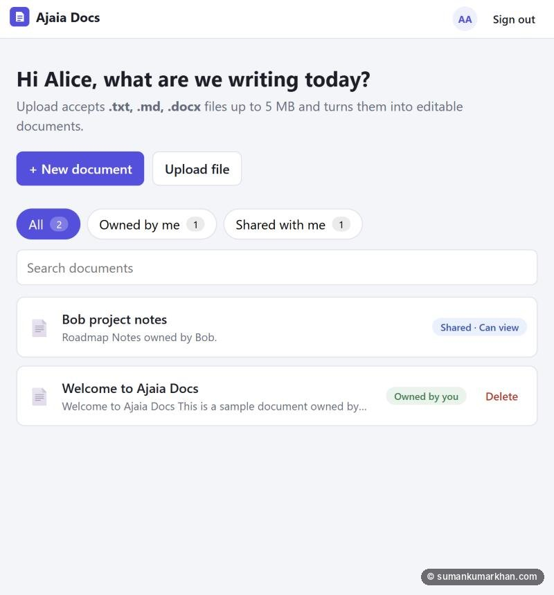
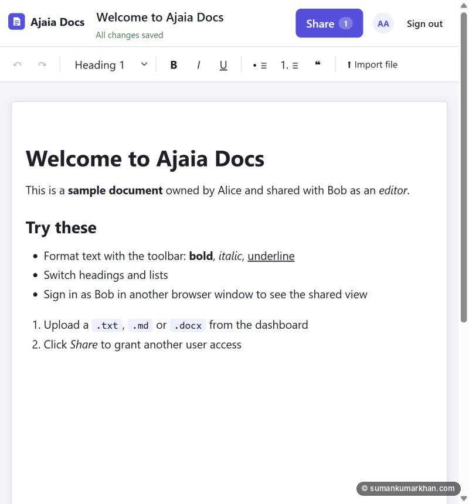
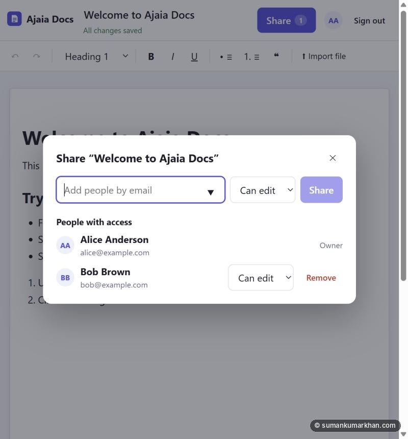
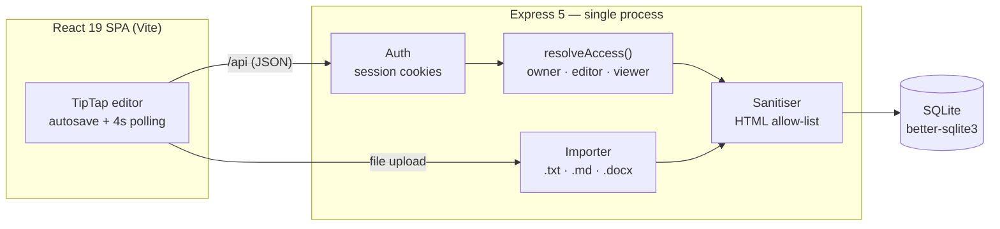
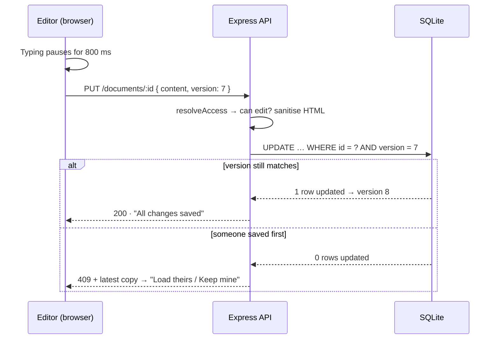

# 📝 Ajaia Docs

**A lightweight collaborative document editor — a "Google Docs-lite" built as a time-boxed engineering take-home.**

Create and format documents in the browser, import `.txt` / `.md` / `.docx` files, and share them with other people as **viewer** or **editor**.

> 🔒 **Source code is private.** This repository is a project showcase only. © 2026 Suman Kumar Khan — all rights reserved. See [LICENSE](LICENSE).

---

## 📸 Screenshots

| Editor | Share dialog |
| --- | --- |
|  |  |

---

## 🎯 Try it

Open the [live demo](https://ajaia-docs-a7vi.onrender.com). It runs on Render's free tier, so the first load can take ~30 seconds to wake up, and data resets on redeploy.

All demo accounts use the password **`password123`** (the login page has one-click buttons):

| User | Email | Starting state |
| --- | --- | --- |
| Alice Anderson | `alice@example.com` | Owns the sample "Welcome" document |
| Bob Brown | `bob@example.com` | Has **editor** access to Alice's document |
| Carol Chen | `carol@example.com` | No access yet — share with her to test |

**2-minute tour:** sign in as Alice → edit and format the Welcome doc → **Share** it with Carol as *Can view* → open a private window as Carol (read-only, "Shared with me") → switch Carol to *Can edit* and watch her page upgrade itself within ~4 seconds.

---

## ✨ Features

| Area | What it does |
| --- | --- |
| **Rich-text editing** | Bold, italic, underline, headings 1–3, bulleted and numbered lists, quotes, undo/redo, keyboard shortcuts and Markdown-style input rules |
| **Autosave** | Debounced saves with a live status line (*Unsaved changes → Saving… → All changes saved*), retry on failure and a warning before closing with unsaved work |
| **File import** | Upload `.txt`, `.md` or `.docx` (up to 5 MB) as a new document, or import a file's contents at the cursor. Headings, lists and emphasis are converted to editable rich text |
| **Sharing** | One owner per document; share by email as **viewer** or **editor**, change roles and revoke. Dashboard filters (*All / Owned by me / Shared with me*) with ownership badges |
| **Near-live updates** | Other people's changes and role changes appear within ~4 seconds without a refresh |
| **Conflict handling** | If two people save over each other, the second person gets an in-app choice: *Load their version* or *Keep mine* — no silent data loss |

---

## 🏗️ Architecture

One deployable container: Express serves both the API and the built front end, so there's one URL, no CORS and one thing to host.

### How a save works

---

## 🧠 Key engineering decisions

| Decision | Why | Trade-off |
| --- | --- | --- |
| **TipTap (ProseMirror)** editor | Real rich-text semantics without hand-rolling `contentEditable` | ~215 KB gzipped bundle |
| **Documents stored as sanitised HTML** | Round-trips formatting exactly and makes `.md` / `.docx` import a simple "convert to HTML" step | JSON would be better for future diffing and collaboration |
| **Server-side sanitisation** with an allow-list | Content comes from editors *and* uploaded files, and other users render it — the server never trusts client HTML, so stored XSS is blocked | Anything not on the allow-list (tables, images) is dropped |
| **One access function** (`resolveAccess`) | Every route asks one place who can read, edit or manage, so the rules can be reviewed and tested in one spot | No groups or link sharing yet |
| **404, not 403, for unshared docs** | Doesn't reveal that a document ID exists | Slightly less specific error |
| **Optimistic concurrency** (`version` column) | Prevents last-write-wins data loss; the loser gets a `409` and chooses what to keep | Detects conflicts rather than merging them (that would need CRDTs like Yjs) |
| **Polling instead of WebSockets** | Makes sharing feel live in ~15 lines; pauses in hidden tabs and catches up on focus | Fine for tens of users, not thousands |
| **SQLite** | Zero setup for reviewers, transactional, foreign keys and role `CHECK` constraints | Single writer; swap to Postgres behind the same queries to scale |

### 🔐 Access model

| Action | Owner | Editor | Viewer | No access |
| --- | :-: | :-: | :-: | :-: |
| Read | ✅ | ✅ | ✅ | 404 |
| Edit content / rename | ✅ | ✅ | 403 | 404 |
| Share / change roles / revoke | ✅ | 403 | 403 | 404 |
| Remove *yourself* from a share | — | ✅ | ✅ | 404 |
| Delete document | ✅ | 403 | 403 | 404 |

**Security:** bcrypt password hashes, random 256-bit session tokens in `HttpOnly`, `SameSite=Lax` cookies (`Secure` in production), server-side HTML sanitisation, and upload type/size validation with clear rejections for empty, corrupt or oversized files.

---

## ✅ Testing & verification

- **16 server tests** (`node:test` + `supertest`, in-memory SQLite) — auth, create/edit/reopen with formatting intact, validation, XSS stripping, `409` conflicts, **every cell of the access matrix**, and every upload path including a real generated `.docx`
- **5 client tests** (Vitest) — upload validation and formatting helpers
- **Manual end-to-end pass** in a real browser as three different users, plus a smoke test of the live Render deployment

---

## 🤖 Built with AI — and verified by hand

I used **Claude Code** as a pair programmer for scaffolding, tests and driving the browser through the app. The value was in checking its output, not trusting it. Real bugs I caught and fixed:

- **Opening a document triggered a save** — TipTap's `setEditable` emits an update by default, which caused bogus "no edit access" toasts for viewers and false conflicts for editors. Found in the browser pass and fixed.
- **Text ran together in document previews** ("RoadmapNotes") — fixed block-boundary handling and added a regression test.
- **Live updates seemed broken in hidden tabs** — polling correctly pauses there; added a catch-up when the tab becomes visible again.
- **First Render deploy failed** — the native SQLite module had no compiler in the slim Docker image; fixed with a dedicated build stage.

---

## 🛣️ What I'd build next

1. Real-time co-editing with **Yjs** and presence cursors
2. **Version history** with restore (the `version` column makes this a small step)
3. **Markdown / PDF export**
4. Sign-up and **invite-by-email** for people without an account
5. **Playwright** end-to-end tests for the editor and sharing flows

---

Built by **[Suman Kumar Khan](https://sumankumarkhan.com/)** · [LinkedIn](https://www.linkedin.com/in/suman-kumar-khan/) · [GitHub](https://github.com/SUMAN-24)

🔒 The source code stays private. I'm happy to walk through it once I've been hired and onboarded.

